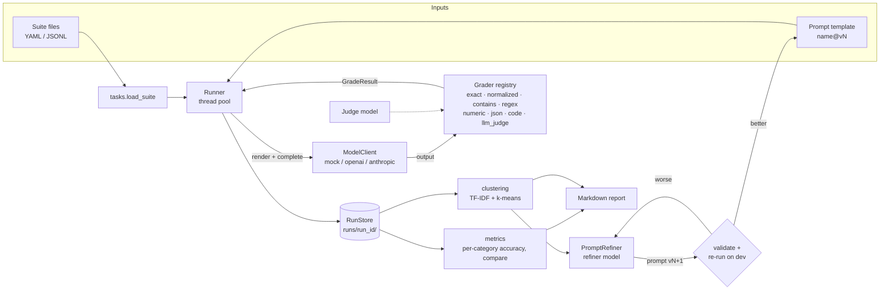

# EvalKit

**EvalKit** is a Python harness for benchmarking LLM outputs against expected solutions.
You describe tasks as data, grade the model's answers with automated graders, see which
kinds of failures keep happening, and let a refinement loop rewrite the prompt to fix them.
Every run is saved so you can track accuracy from one run to the next.

- **Task suites as data:** YAML/JSONL files with a category, input variables, an expected
  solution and a grader spec for each task.
- **Automated graders:** exact, normalized (SQuAD-style with token F1), contains, regex,
  numeric tolerance, JSON field match, Python code execution against test cases, and
  LLM-as-judge. Each grader returns pass/fail plus a score in 0 to 1 and a reason.
- **Provider-agnostic:** `mock` (offline, scripted), `openai` (works with any
  OpenAI-compatible server) and `anthropic`, all called over plain HTTPS through `httpx`,
  with retries and backoff.
- **Failure clustering:** TF-IDF and k-means over the failure reasons and outputs, with
  numbers masked out. `k` is picked by silhouette score. Each cluster gets a label made
  from its top terms and comes with representative examples.
- **Iterative prompt refinement:** a refiner model reads the failure clusters, proposes a
  new prompt version, and the new version is checked and scored on a dev split. It is kept
  only if dev accuracy goes up. The loop stops early when there is no improvement, and an
  optional holdout split guards against overfitting.
- **Run tracking:** each run is written to `runs/<run_id>/`. You can render a Markdown
  report, cluster a run's failures, or diff two runs to see which tasks were fixed or
  regressed.

## Architecture



```
evalkit/
├── types.py          Task, ModelResponse, GradeResult, TaskResult
├── tasks.py          suite loading/validation (YAML, JSONL, JSON, directories)
├── prompts.py        versioned PromptTemplate (system + user, strict formatting)
├── models/           ModelClient base (retry/backoff), mock, OpenAI, Anthropic, factory
├── graders/          registry + text, numeric, json_match, code_exec, llm_judge
├── runner.py         concurrent evaluation -> EvalRun
├── metrics.py        summaries by category, run-to-run comparison
├── storage.py        RunStore: config.json, results.jsonl, summary.json
├── clustering.py     failure clustering
├── refine.py         refinement loop, refiner meta-prompt, holdout split
├── report.py         Markdown rendering
└── cli.py            `evalkit` command
```

## Installation

Requires Python 3.10+.

```bash
python -m venv .venv && source .venv/bin/activate
pip install -e ".[dev]"
cp .env.example .env   # only needed for real providers
```

| Variable | Used by |
|---|---|
| `OPENAI_API_KEY` | `--model openai:<model>` |
| `OPENAI_BASE_URL` | optional; point at vLLM, Ollama, LM Studio, etc. |
| `ANTHROPIC_API_KEY` | `--model anthropic:<model>` |

`.env` is loaded automatically and never overrides variables that are already exported.
The `mock` provider needs no keys and no network access.

## How to run

### 1. Run an evaluation

Offline, using the scripted mock answers that ship with the examples:

```bash
evalkit run \
  --suite examples/suites \
  --prompt examples/prompts/baseline.yaml \
  --model mock --mock-rules examples/mock_rules.yaml
```

Against a real model, with a judge for the `llm_judge` tasks:

```bash
evalkit run -s examples/suites -p examples/prompts/structured.yaml \
  -m openai:gpt-4o-mini --judge anthropic:claude-sonnet-4-5 -j 8
```

The command prints one progress mark per task (`.` pass, `F` fail, `E` error) and a
Markdown report, then saves the run under `runs/`. Use `--category`/`-c` (repeatable) and
`--limit` to run a subset. Use `--fail-under 0.8` to exit non-zero in CI when accuracy
drops below a threshold.

> The example suite includes one `llm_judge` task. If you don't pass `--judge`, that task
> is reported as a grader error and the rest of the run continues.

### 2. Inspect, cluster and compare

```bash
evalkit list                              # every stored run with its accuracy
evalkit report latest --clusters -o report.md
evalkit cluster latest                    # also writes runs/<id>/clusters.json
evalkit compare <baseline_run_id> <candidate_run_id>
```

### 3. Refine a prompt

```bash
evalkit refine -s examples/suites -p examples/prompts/baseline.yaml \
  -m openai:gpt-4o-mini --refiner anthropic:claude-sonnet-4-5 \
  --iterations 4 --patience 2 --holdout 0.25
```

Each iteration clusters the failures of the current best prompt. The refiner sees the
template, the accuracy and representative failures, and returns
`<analysis>/<system>/<user>` blocks. A proposal is rejected if it drops or adds template
variables or fails to render. Results are written to
`runs/refinements/<prompt>/refinement.json`, and the best template is saved as
`<prompt>.v<N>.yaml`, ready to pass back to `--prompt`.

### Writing suites

```yaml
defaults:
  category: arithmetic
  grader: { type: numeric, extract: last_number, abs_tol: 0.01 }
tasks:
  - id: arith-001
    input: { question: "How much do 14 pens at $3 cost?" }
    expected: 42
  - id: code-001
    category: code
    input: { question: "Write is_even(n)" }
    expected: ["assert is_even(2)", { call: "is_even(3)", expected: false }]
    grader: { type: code, timeout_s: 5 }
```

Every grader accepts `extract`: `last_line`, `last_number`, `code_block` or
`regex:<pattern>`. Prompt templates use `str.format` placeholders named after the keys in
each task's `input`. Write literal braces as `{{ }}`.

> **Security note:** the `code` grader runs generated code in a separate Python process
> with a temporary working directory, a stripped environment and a timeout. That is
> isolation, not a sandbox. Run untrusted model code inside a container or VM.

## How to test

The test suite runs fully offline on the mock provider:

```bash
pip install -e ".[dev]"
pytest -q
ruff check .
```

| File | Covers |
|---|---|
| `tests/test_tasks_and_prompts.py` | suite formats, validation, prompt rendering/versioning |
| `tests/test_graders.py` | answer extraction and every grader (including subprocess code execution) |
| `tests/test_runner_and_storage.py` | concurrency/order, error capture, retries, metrics, run store |
| `tests/test_clustering.py` | masking, single-cluster fallback, separation of distinct error modes |
| `tests/test_refine.py` | refiner parsing/validation, improvement loop, patience, holdout |
| `tests/test_cli.py` | end-to-end `run`, `report`, `cluster`, `compare`, `list`, `--fail-under` |

## License

MIT
